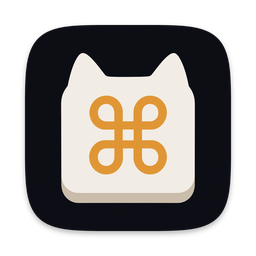
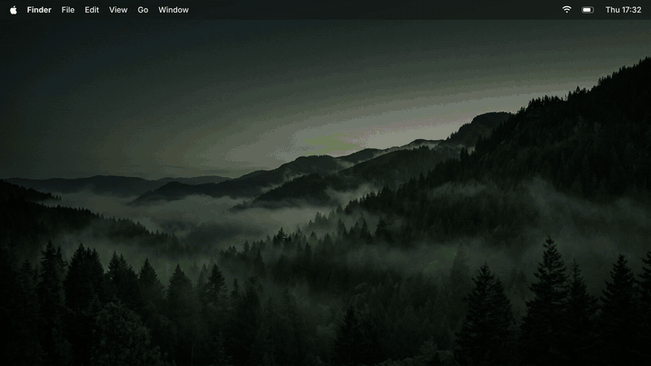
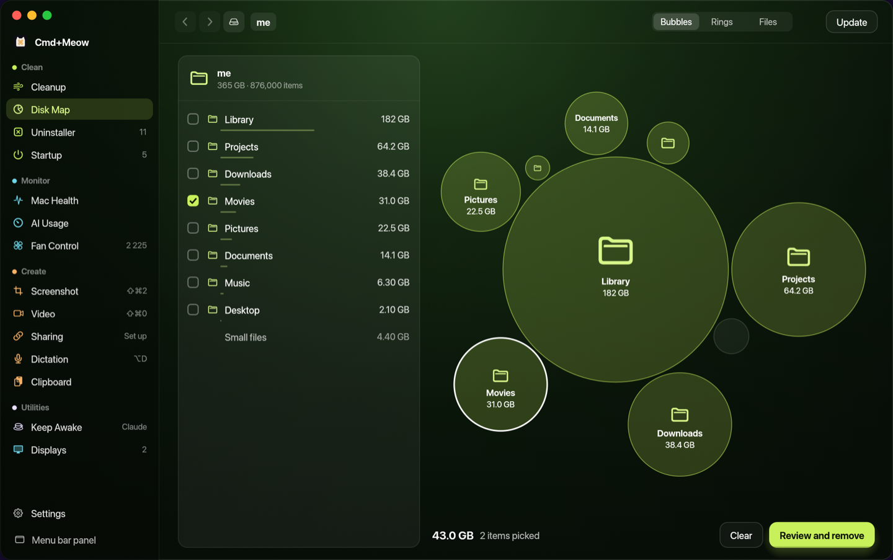
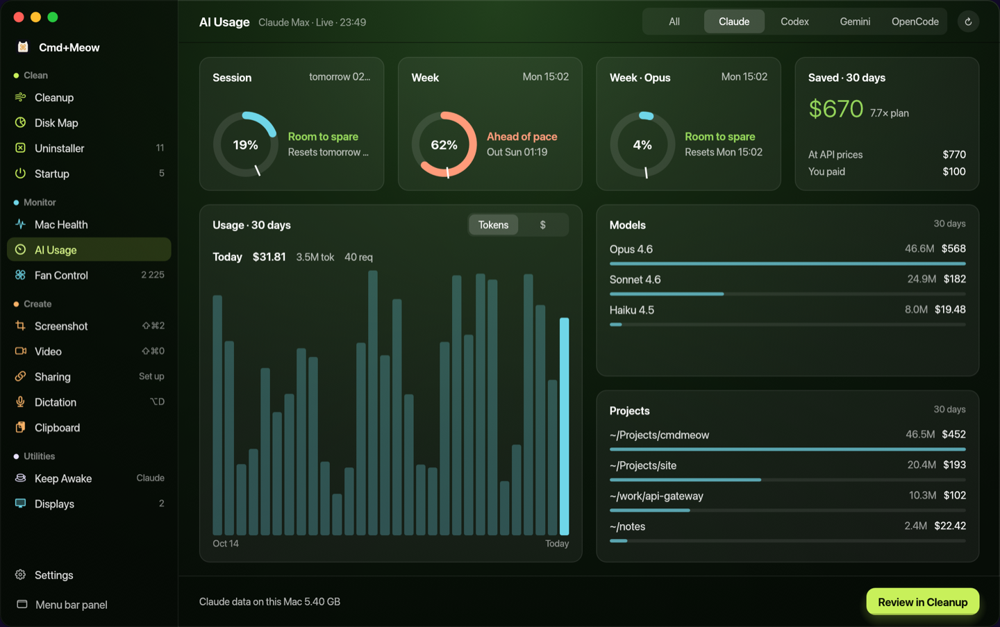
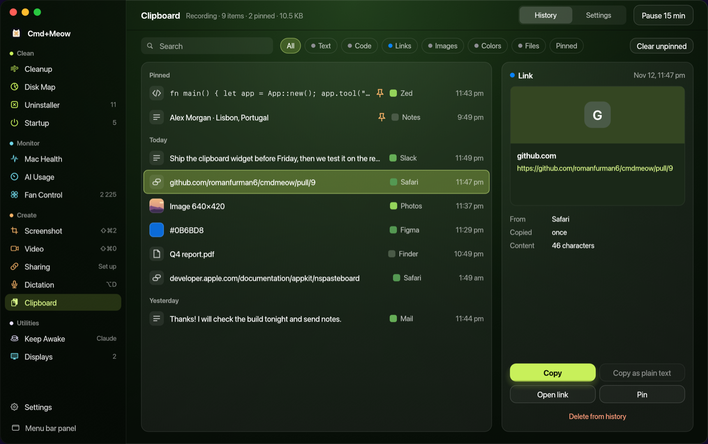
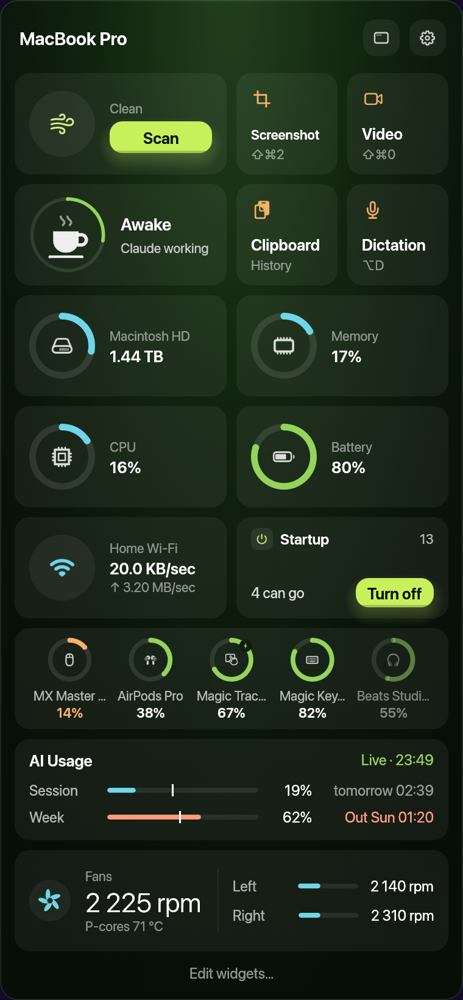

<p align="center">
  
</p>

<h1 align="center">Cmd+Meow</h1>

<p align="center"><b>Everything your Mac needs. Free.</b><br>
Fourteen Mac tools in one menu bar app. Open source, no account, runs locally.</p>

<p align="center">
  <a href="https://github.com/romanfurman6/cmdmeow/releases/latest/download/CmdMeow.dmg"><b>Download for macOS</b></a> ·
  <a href="https://cmdmeow.com">Website</a> ·
  <a href="https://github.com/romanfurman6/cmdmeow/releases">Releases</a>
</p>

<p align="center">
  <a href="https://github.com/romanfurman6/cmdmeow/releases/latest"></a>
  
  <a href="LICENSE"></a>
  <a href="https://github.com/romanfurman6/cmdmeow/actions/workflows/macos.yml"></a>
</p>

<p align="center">
  <a href="https://cmdmeow.com/promo.mp4"></a>
</p>

## Install

1. Download [CmdMeow.dmg](https://github.com/romanfurman6/cmdmeow/releases/latest/download/CmdMeow.dmg) and drag Cmd+Meow to Applications.
2. The app is signed but not notarized yet, so the first launch is blocked. Open it once, then click **Open Anyway** in System Settings › Privacy & Security.
   Or run `xattr -dr com.apple.quarantine /Applications/CmdMeow.app`.
3. First-run setup asks only for the permissions of the tools you turn on.

Needs macOS 12 or later, Apple silicon or Intel.

## What's inside

| Tool | What it does |
| --- | --- |
| **Cleanup** | Caches, logs and leftovers, reviewed before anything moves to the Trash |
| **Disk Map** | What takes space, as live bubbles you can drill into |
| **Uninstaller** | Removes apps together with their leftovers |
| **Startup** | Login items, agents and daemons; flags what you don't need |
| **Mac Health** | CPU, memory, disk, battery, Wi-Fi speed test, Bluetooth batteries |
| **AI Usage** | Claude, Codex, Gemini and OpenCode limits, pace and cost |
| **Fan Control** | Fan speeds, chip heat map, fixed speed or your own curve |
| **Screenshot** | Area, window or screen, an editor with arrows, blur and text |
| **Video** | Screen recording with camera, mic and system audio |
| **Sharing** | Upload a shot or a recording to your own S3 and copy a link |
| **Dictation** | ⌥D types what you say at the caret; speech stays on the Mac |
| **Clipboard** | History with search, pins and quick paste |
| **Keep Awake** | Keeps the Mac awake, also while Claude Code works |
| **Displays** | Brightness and volume of external monitors from your keys |

Every tool can be turned off, and the panel is a grid of widgets you arrange
yourself.







<p align="center">
  
</p>

### Instead of

CleanMyMac, DaisyDisk, CleanShot X, Loom, Paste, iStat Menus, Wispr Flow and
Amphetamine each do one of these jobs. Cmd+Meow does them in one free app.

<sub>CleanMyMac, DaisyDisk, CleanShot X, Loom, Paste, iStat Menus, Wispr Flow and
Amphetamine are trademarks of their owners. Cmd+Meow is not affiliated with them.</sub>

### Automation

Every action has a link for scripts, Raycast or Shortcuts: `open cmdmeow://…`
(the Dev build answers `cmdmeow-dev://`).

| Link | Does |
| --- | --- |
| `awake/on`, `awake/off`, `awake/toggle` | Keep Awake |
| `capture/area`, `window`, `screen`, `delayed`, `text`, `color`, `ruler`, `record`, `history` | Screenshot and Video |
| `dictation/toggle`, `start`, `stop`, `cancel` | Dictation |
| `open/<tool>[/<page>]`, e.g. `open/disk-map`, `open/capture/settings`, `open/settings` | Open a page |

## Privacy and safety

- No account, no telemetry. Files, clipboard, recordings and dictation never leave the Mac unless you share them.
- Crash reports are opt-in: official releases ask once during setup (and in Settings › General). If you agree, a crash sends the error, stack trace, app and macOS version to Sentry. No files, hostname or IP address, and the home folder is replaced with `~`. Builds from source never send anything.
- Cleanup never reads file contents. If you turn on the AI review, only paths, sizes and ages go to Claude.
- Documents, Desktop, Projects, Keychains, `.ssh` and any folder with `.git` are always kept.
- Removed items go to the Trash unless you choose "Delete right away".

## Development

- macOS (uses AppKit for the glass material and menu bar behavior)
- Rust stable (edition 2021)
- Optional: [Claude Code CLI](https://docs.anthropic.com/en/docs/claude-code) signed in, for Claude limits in AI Usage and the Cleanup AI judge

```bash
git clone https://github.com/romanfurman6/cmdmeow
cd cmdmeow
cargo run --release            # menu bar app
cargo test                     # unit tests
```

```bash
scripts/bundle-mac.sh              # target/bundle/CmdMeow.app + .zip
UNIVERSAL=1 scripts/bundle-mac.sh  # Apple silicon + Intel
```

CI (`.github/workflows/macos.yml`) runs the tests and builds a universal
`CmdMeow.app` on every push and PR; download it from the run's
**Artifacts**.

<details>
<summary><b>Releases, signing and notarization</b></summary>

Versions follow semver; `Cargo.toml` is the source of truth. The app's
Info.plist gets it as `CFBundleShortVersionString`, the commit count as
`CFBundleVersion`, and Settings › General shows both ("Cmd+Meow 0.2.0 (57)").

```sh
scripts/release.sh patch   # or minor, major, or an exact 0.2.0
```

On a clean, up-to-date `main` (needs `gh`, signed in) this bumps the version
on a `release/vX.Y.Z` branch, merges it through a PR (`main` only takes PRs:
no direct pushes, force pushes or deletion), tags the merged commit `vX.Y.Z`
and pushes the tag. Then:

1. The tag starts `.github/workflows/release.yml` on the M1 runner. The job
   runs in the protected **`release`** environment and waits.
2. GitHub notifies Roman: open the run › **Review deployments** › tick
   `release` › **Approve and deploy**. Only then does the job get the signing
   secrets.
3. Tests, universal build, sign, notarize, then a GitHub Release with
   generated notes and `CmdMeow.dmg`, `CmdMeow.zip`, `SHA256SUMS.txt`,
   `latest.json`.

The asset names never change, so
`https://github.com/romanfurman6/cmdmeow/releases/latest/download/CmdMeow.zip`
always points to the newest version (the website's Download button uses it).

#### In-app updates

`latest.json` holds the version, this tag's zip URL and its sha256. The app
reads `releases/latest/download/latest.json` 15 s after launch and every 6 h;
a newer version shows a banner in the panel, and **Update** downloads the zip,
checks the sha256, the code signature (same Apple team), bundle id and
version, swaps the app and relaunches (`src/kit/update.rs`). Publishing the
Release is the whole rollout. Tags with a `-` (`v0.2.0-beta.1`) are
prereleases and are never offered. Test locally with
`CMDMEOW_UPDATE_URL=file:///path/latest.json` (works in the dev build too).

#### Signing and notarization

Release builds are signed with **Developer ID Application** and notarized with
these secrets. They are **environment secrets of `release`** (Settings ›
Environments › release), not repository secrets, so no other workflow can use
them. The environment requires Roman's approval, allows only `v*` tags, and
admins can't bypass it. Without the secrets the release is ad-hoc signed and
users must right-click › Open.

| Secret | Value |
| --- | --- |
| `MACOS_CERT_P12` | `base64 -i DeveloperID.p12` (certificate + private key) |
| `MACOS_CERT_PASSWORD` | password of that .p12 |
| `NOTARY_KEY_P8` | contents of the App Store Connect API key `AuthKey_XXXX.p8` |
| `NOTARY_KEY_ID` | that key's Key ID |
| `NOTARY_ISSUER_ID` | Issuer ID from App Store Connect › Users and Access › Integrations |
| `SENTRY_DSN` | Sentry project DSN for crash reports (Project Settings › Client Keys). Compiled into release builds only |

The signed app runs with the hardened runtime and `assets/CmdMeow.entitlements`
(microphone, camera, Apple Events).

Current releases (0.1.0, 0.1.1) are Developer ID signed but not notarized:
Apple hasn't finished setting up the developer account yet, and
`release.yml` publishes without notarization (the release name says so) until
it can. See [Install](#install) for the first launch.

Coming from CleanMeBro (the old name; bundle id is now
`com.romanfurman6.cmdmeow`): the new bundle id makes it a new app to macOS. Grant
Screen Recording, Accessibility and Full Disk Access again, turn **Open at
login** back on, and delete the old app. Settings, clipboard history and the
sharing key move over on first launch. The fan helper keeps its old id, so an
installed helper keeps working.

The icon artwork is `assets/icon/AppIcon-art.png`; regenerate `assets/AppIcon.icns`
with `python3 scripts/make-icon.py` (needs `pip install pillow`). The menu bar
icon is drawn from vector paths in `src/kit/brand.rs`.

</details>

<details>
<summary><b>Test and preview modes</b></summary>

```bash
# Read-only Cleanup check: prints what would be offered, removes nothing
cargo run --release -- --scan-report
cargo run --release -- --scan-report --ai     # also ask Claude to judge

# Render a view with sample data to a PNG and exit
cargo run --release -- --screenshot out.png --view panel
```

`--view` values: `panel`, `customize` (Settings › Widgets), `settings-tools`,
`storage`, `memory`, `battery`, `cpu`, `network`, `devices`, `claude-detail`,
`cleanup`, `results`, `lens`, `lens-live`, `claude`, `clipboard`,
`clipboard-settings`, `clipboard-quick`, `clipboard-list`.

</details>

<details>
<summary><b>Architecture</b></summary>

The app is a small **core** (the shell) plus independent **tools**. Each tool
is one folder under `src/tools/` and implements the `Tool` trait
(`src/core/tool.rs`). A tool can offer any of: panel widgets, detail sheets,
a page in the full window, recommendations and the menu-bar title.

- Tools never import each other (a test enforces it). To link to another tool
  they ask the core by id, e.g. `cx.open_page("cleanup", "claude")`; if that
  tool isn't installed, nothing happens.
- Shared code that several tools need lives in `src/kit/` and knows no tool.
- The panel lays widgets out on a 4-column grid: each widget spans 1, 2 or 4
  columns and reports its own height. The panel grows with its widgets and
  scrolls past the screen height.

#### Adding a tool

1. Create `src/tools/<name>/mod.rs` with a struct implementing `Tool`
   (`id`, `name`, `badge` are required; everything else is optional).
2. Add one line to `all()` in `src/tools/mod.rs`.

Its widgets appear in the gallery of **Settings › Widgets**, it gets an
on/off switch in **Settings › Tools**, and if it has a page it gets a sidebar
entry. Nothing in `src/core/` changes.

</details>

<details>
<summary><b>Project layout</b></summary>

```
cmdmeow/
├── Cargo.toml / Cargo.lock
├── src/
│   ├── main.rs              entry point, CLI flags
│   ├── core/                the shell; knows tools only through the trait
│   │   ├── tool.rs          Tool trait, widget specs, actions, Cx
│   │   ├── shell.rs         tray icon, panel ⇄ full window, actions, screenshots
│   │   ├── panel.rs         widget grid, recommendation, footer, Open button, detail sheet
│   │   ├── editor.rs        Settings: drag-and-drop widget editor, tools on/off
│   │   ├── window.rs        full window: sidebar of tool pages and Settings
│   │   ├── layout.rs        4-column widget packing
│   │   └── settings.rs      saved widget order, visibility and tools turned off
│   ├── kit/                 shared by all tools
│   │   ├── glass.rs         drawing kit: glass cards, gradients, glows, vector icons
│   │   ├── brand.rs         the Cmd+Meow mark as vector paths (menu bar icon)
│   │   ├── controls.rs      shared page controls (round action button)
│   │   ├── native.rs        macOS: glass material, menu-bar app, thermal state, Trash
│   │   ├── fs.rs            folder sizes, protected paths, move to Trash, disk space
│   │   ├── claude_code.rs   Claude Code CLI and project discovery
│   │   ├── ai/              AI usage providers and API prices
│   │   └── mechanics.rs     numbers/thresholds from docs/MECHANICS.md
│   └── tools/
│       ├── mod.rs           the tool list (the only place that names tools)
│       ├── system/          Mac Health: readings, widgets, detail sheets
│       ├── cleanup/         junk rules, AI judge, removal, --scan-report
│       ├── lens/            Disk Map: folder measuring and live bubbles
│       ├── uninstaller/     apps, leftovers, drop-to-uninstall widget
│       ├── startup/         login items, launch agents and daemons
│       ├── capture/         Screenshot, Video and Sharing (one engine, three tools)
│       ├── dictation/       speech to text at the caret
│       ├── clipboard/       clipboard history and quick paste
│       ├── fan/             fan speeds, temperatures, helper
│       ├── keep_awake/      keep the Mac awake, also while Claude works
│       ├── displays/        brightness and volume of external displays
│       └── claude/          AI Usage: usage of Claude, Codex, Gemini, OpenCode
├── vendor/eframe/        eframe 0.37 with one patch (see Cargo.toml)
├── docs/
│   ├── images/          README screenshots
│   ├── MECHANICS.md     rules, thresholds and where each came from
│   └── mechanics.json   same data, machine-readable
├── assets/
│   ├── AppIcon.icns     app icon, all sizes (generated)
│   └── icon/AppIcon-art.png icon artwork
├── scripts/
│   ├── bundle-mac.sh    build CmdMeow.app + zip
│   └── make-icon.py     artwork → AppIcon.icns
└── .github/workflows/macos.yml   CI: test, build, upload the app
```

The images in `docs/images/` are rendered from sample data with
`--screenshot <file.png> --view <name>`.

</details>

## License

MIT, see [LICENSE](LICENSE).
