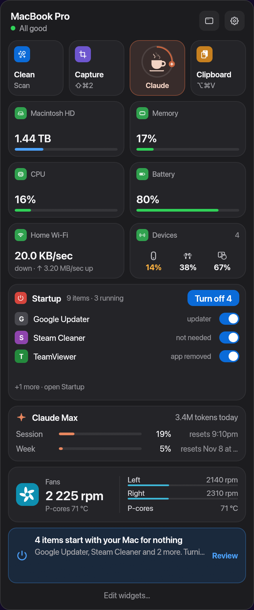
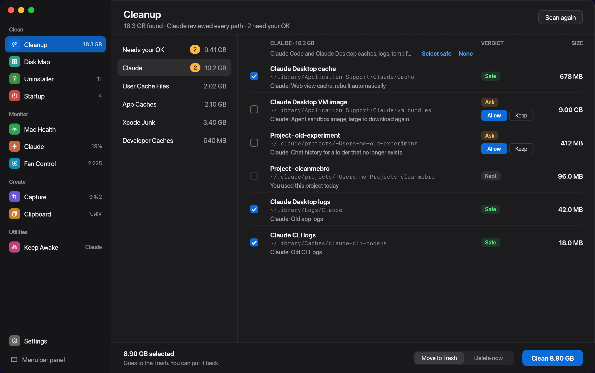
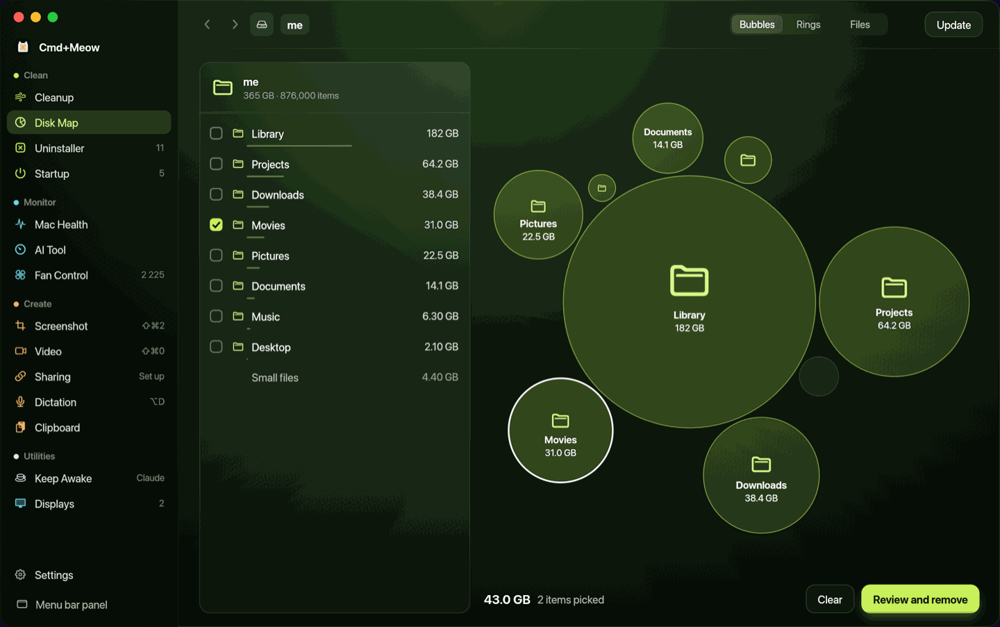
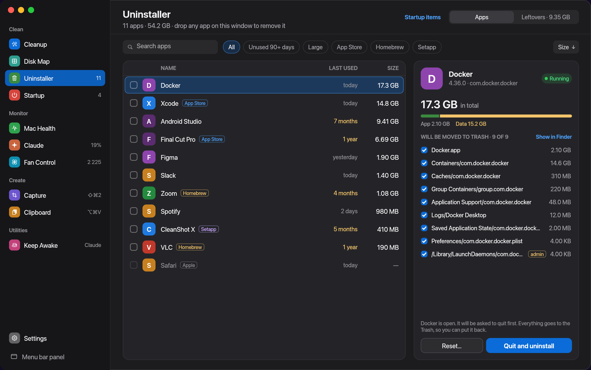
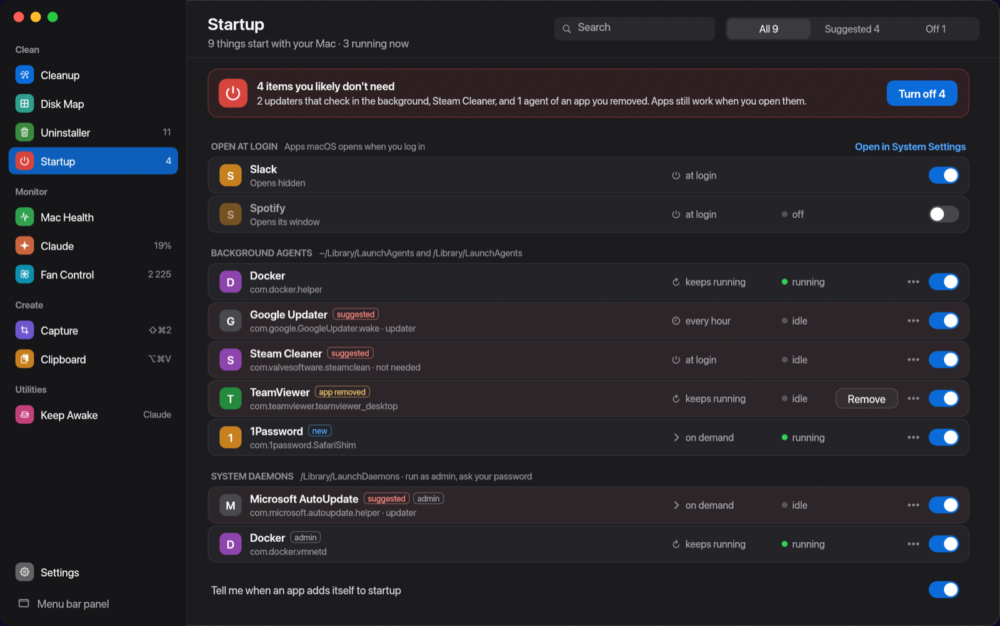
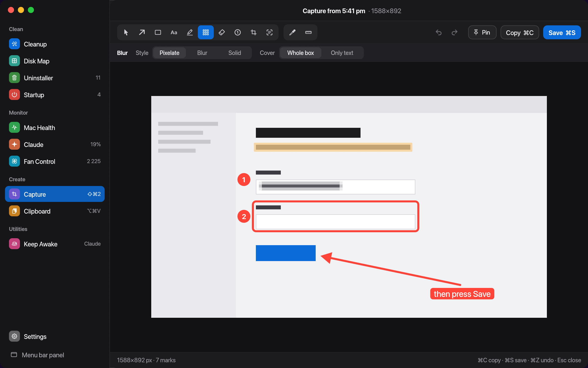
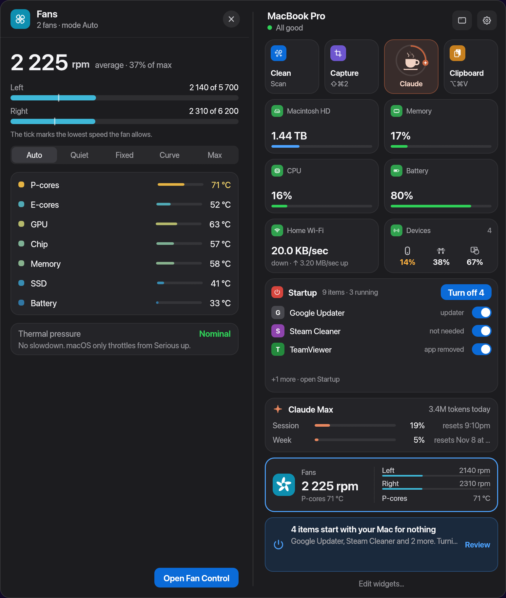
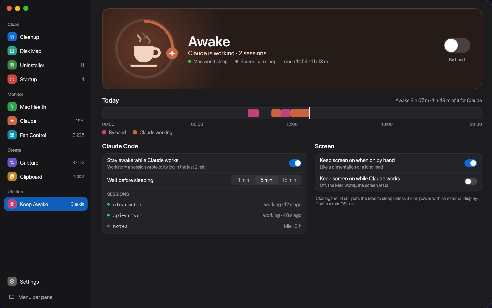
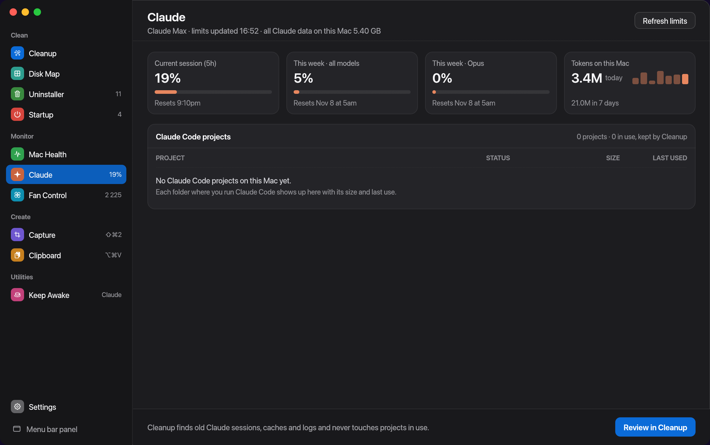
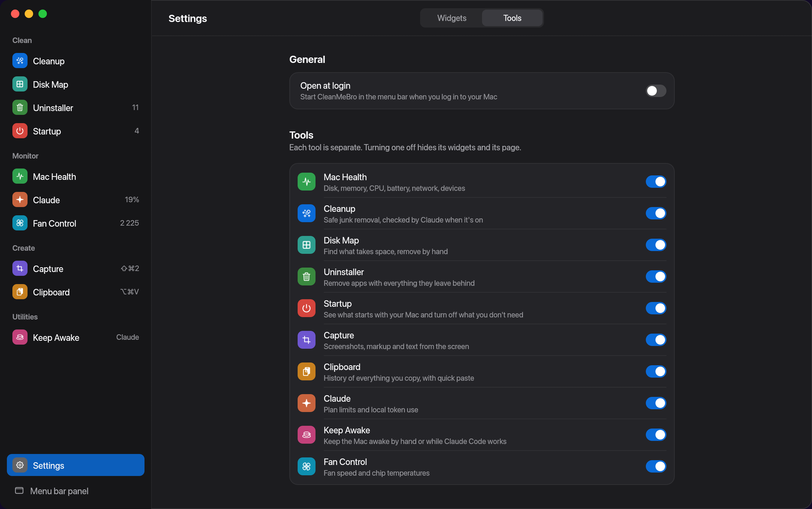

# CleanMeBro

One menu bar app for keeping a Mac in shape. It puts a disk cleaner, an app
uninstaller, startup items, a disk map, fan control, a screenshot and screen
recording tool, clipboard history and keep-awake in one place, and every part
can be turned off.

Written in Rust (eframe/egui) with native AppKit, ScreenCaptureKit and Core
Animation where it matters. Everything runs locally. The optional Claude
integration only ever sees file paths, never file contents.

<p align="center">
  
</p>

## What it does

### The menu bar panel

Click the menu bar icon for a panel of widgets: disk, memory, CPU, battery,
network, Bluetooth device batteries, startup items, Claude limits and fans,
plus one recommendation for today. Widgets come in several sizes; drag them
around and pick which to show in **Settings › Widgets**. Clicking a widget
opens its detail sheet or its tool page in the full window.

### Cleanup

Finds junk by rule: user and app caches, logs, Xcode data, package manager
downloads, leftovers of AI tools and the Trash. Claude can review every path
and mark it **Safe**, **Ask** or **Keep**; anything unclear waits for your OK.
What you keep is remembered and hidden next time. Items go to the Trash by
default.



### Disk Map

Measures a disk or folder and shows it as a treemap you can drill into. Pick
what to remove and send it to the Trash after a review. It runs only when you
ask.



### Uninstaller

Lists your apps with size and last use. Removing one also removes its
support files, caches, preferences, containers and launch agents, which are
all shown before anything moves. It also finds leftovers of apps that are
already gone, and you can drop an app on a widget to uninstall it.



### Startup

Login items, launch agents and launch daemons in one list, with what each one
runs and when. It suggests what's safe to turn off (updaters, helpers of
removed apps) and turns them off in one click, with undo. It tells you when
something new adds itself.



### Capture

Screenshots of an area, a window or the whole screen (⇧⌘2), with an editor
for arrows, shapes, text, numbered steps, highlight, blur, crop, a
ruler and a color picker. Screen recording
(⇧⌘0) records a display, a window or an area with system audio, microphone
and a camera bubble. Recordings open in a small editor with trim, local
speech-to-text (Whisper) and noise removal, and can be uploaded to your own
S3-compatible storage for a share link.



### Clipboard

A history of what you copy (text, links, code, colors, images and files),
kept on this Mac. ⌥⌘V opens quick paste over any app: type to search, ↵ to
paste. Password managers and concealed items are skipped.

### Fan Control

Fan speeds and temperatures, with Auto, Quiet, Fixed, Curve and Max modes.
Changing speed uses a small privileged helper that you install once.



### Keep Awake

Keeps the Mac awake with one switch, or by itself while Claude Code is
working (and a few minutes after, so a pause between prompts doesn't put it
to sleep). It uses the same power assertions as `caffeinate`.



### Claude

Your Claude plan limits (session, week, Opus) and how many tokens were used on
this Mac, read from the Claude CLI without spending tokens. The session
percentage can sit in the menu bar.



### Settings

Turn any tool off and it disappears with its widgets and pages. CleanMeBro
opens at login by default; you can turn that off here.



Every rule and threshold, with its source, is in [docs/MECHANICS.md](docs/MECHANICS.md).

## Requirements

- macOS (uses AppKit for the glass material and menu bar behavior)
- Rust stable (edition 2021)
- Optional: [Claude Code CLI](https://docs.anthropic.com/en/docs/claude-code) signed in, for the Claude card and the AI judge

## Build and run

```bash
cargo run --release            # menu bar app
cargo test                     # unit tests
```

### Build the app

```bash
scripts/bundle-mac.sh              # target/bundle/CleanMeBro.app + .zip
UNIVERSAL=1 scripts/bundle-mac.sh  # Apple silicon + Intel
```

CI (`.github/workflows/macos.yml`) runs the tests and builds a universal
`CleanMeBro.app` on every push and PR; download it from the run's
**Artifacts**. Pushing a `v*` tag also attaches the zip to a GitHub Release.

The app is ad-hoc signed, not notarized. On first launch, right-click it and
choose **Open**, or run `xattr -dr com.apple.quarantine CleanMeBro.app`.

The icon source is `assets/icon/AppIcon.svg`; regenerate `assets/AppIcon.icns`
with `python3 scripts/make-icon.py` (needs `pip install cairosvg pillow`).

### Test and preview modes

```bash
# Read-only Cleanup check: prints what would be offered, removes nothing
cargo run --release -- --scan-report
cargo run --release -- --scan-report --ai     # also ask Claude to judge

# Render a view with sample data to a PNG and exit
cargo run --release -- --screenshot out.png --view panel
```

`--view` values: `panel`, `customize` (Settings › Widgets), `settings-tools`,
`storage`, `memory`, `battery`, `cpu`, `network`, `devices`, `claude-detail`,
`cleanup`, `results`, `lens`, `lens-live`, `claude`, `clipboard`,
`clipboard-settings`, `clipboard-quick`, `clipboard-list`.

## Architecture

The app is a small **core** (the shell) plus independent **tools**. Each tool
is one folder under `src/tools/` and implements the `Tool` trait
(`src/core/tool.rs`). A tool can offer any of: panel widgets, detail sheets,
a page in the full window, recommendations, gear-menu entries and the
menu-bar title.

- Tools never import each other (a test enforces it). To link to another tool
  they ask the core by id, e.g. `cx.open_page("cleanup", "claude")`; if that
  tool isn't installed, nothing happens.
- Shared code that several tools need lives in `src/kit/` and knows no tool.
- The panel lays widgets out on a 4-column grid: each widget spans 1, 2 or 4
  columns and reports its own height. The panel grows with its widgets and
  scrolls past the screen height.

### Adding a tool

1. Create `src/tools/<name>/mod.rs` with a struct implementing `Tool`
   (`id`, `name`, `badge` are required; everything else is optional).
2. Add one line to `all()` in `src/tools/mod.rs`.

Its widgets appear in the gallery of **Settings › Widgets**, it gets an
on/off switch in **Settings › Tools**, and if it has a page it gets a sidebar
entry. Nothing in `src/core/` changes.

## Project layout

```
.
├── Cargo.toml / Cargo.lock
├── src/
│   ├── main.rs              entry point, CLI flags
│   ├── core/                the shell; knows tools only through the trait
│   │   ├── tool.rs          Tool trait, widget specs, actions, Cx
│   │   ├── shell.rs         tray icon, panel ⇄ full window, actions, screenshots
│   │   ├── panel.rs         widget grid, recommendation, footer, gear menu, detail sheet
│   │   ├── editor.rs        Settings: drag-and-drop widget editor, tools on/off
│   │   ├── window.rs        full window: sidebar of tool pages and Settings
│   │   ├── layout.rs        4-column widget packing
│   │   └── settings.rs      saved widget order, visibility and tools turned off
│   ├── kit/                 shared by all tools
│   │   ├── glass.rs         drawing kit: glass cards, gradients, glows, vector icons
│   │   ├── controls.rs      shared page controls (round action button)
│   │   ├── native.rs        macOS: glass material, menu-bar app, thermal state, Trash
│   │   ├── fs.rs            folder sizes, protected paths, move to Trash, disk space
│   │   ├── claude_code.rs   Claude Code CLI and project discovery
│   │   └── mechanics.rs     numbers/thresholds from docs/MECHANICS.md
│   └── tools/
│       ├── mod.rs           the tool list (the only place that names tools)
│       ├── system/          Mac Health: readings, widgets, detail sheets
│       ├── cleanup/         junk rules, AI judge, removal, --scan-report
│       ├── lens/            Disk Map: folder measuring and treemap
│       ├── uninstaller/     apps, leftovers, drop-to-uninstall widget
│       ├── startup/         login items, launch agents and daemons
│       ├── capture/         screenshots, editor, screen recording, sharing
│       ├── clipboard/       clipboard history and quick paste
│       ├── fan/             fan speeds, temperatures, helper
│       ├── keep_awake/      keep the Mac awake, also while Claude works
│       └── claude/          Claude limits: card, sheet, page, tray title
├── vendor/eframe/        eframe 0.37 with one patch (see Cargo.toml)
├── docs/
│   ├── images/          README screenshots
│   ├── MECHANICS.md     rules, thresholds and where each came from
│   └── mechanics.json   same data, machine-readable
├── assets/
│   ├── AppIcon.icns     app icon, all sizes (generated)
│   └── icon/AppIcon.svg icon source
├── scripts/
│   ├── bundle-mac.sh    build CleanMeBro.app + zip
│   └── make-icon.py     SVG → AppIcon.icns
└── .github/workflows/macos.yml   CI: test, build, upload the app
```

The images in `docs/images/` are rendered from sample data with
`--screenshot <file.png> --view <name>`.

## Safety

- Cleanup never reads file contents; only paths, sizes and ages are sent to Claude.
- Hard-kept locations (Documents, Desktop, Projects, Keychains, `.ssh`, any folder
  with `.git`, Claude settings, and so on) can't be overridden by rules or the AI.
- Removal moves to the Trash unless you choose "Delete right away".

## Known gaps

- Some health thresholds are estimated (marked in `docs/MECHANICS.md`).
- Live glass and tray behavior hasn't been visually verified end to end.
